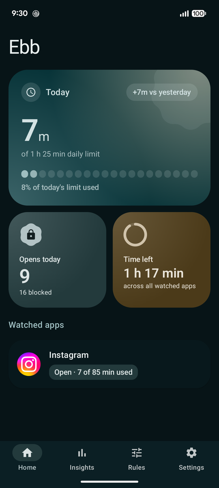
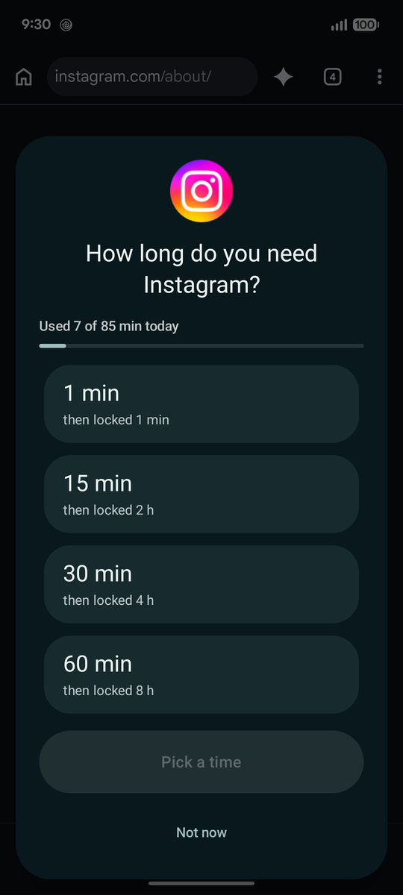
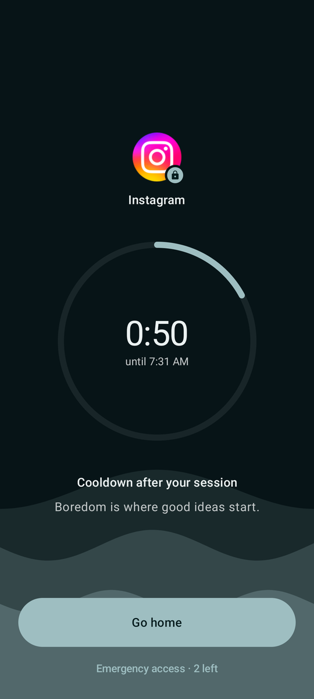
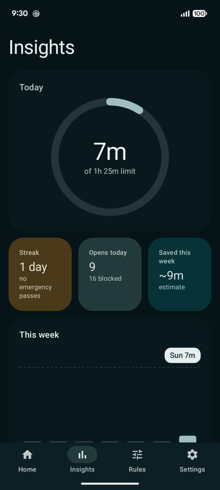
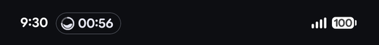
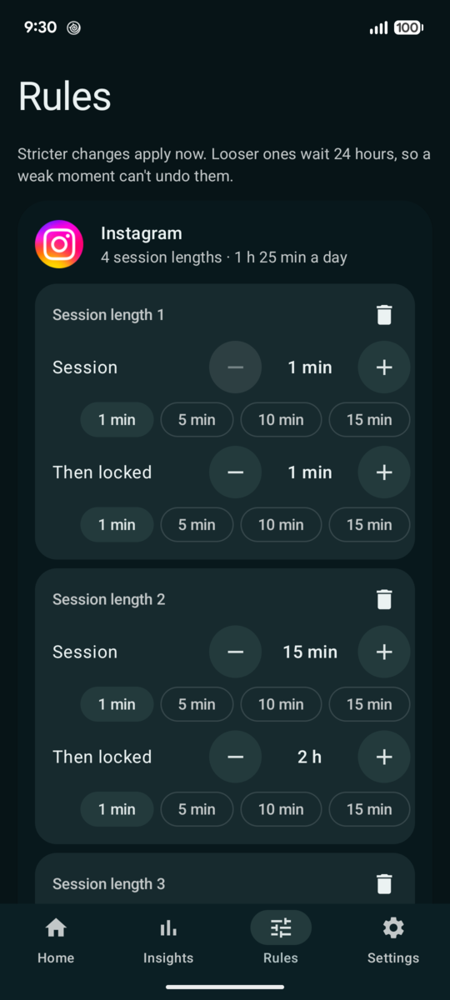
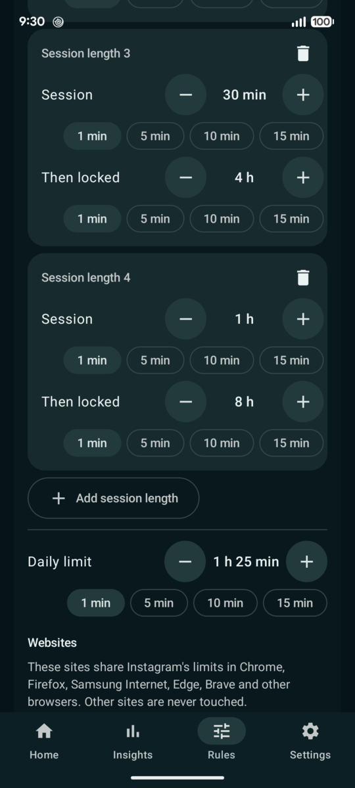
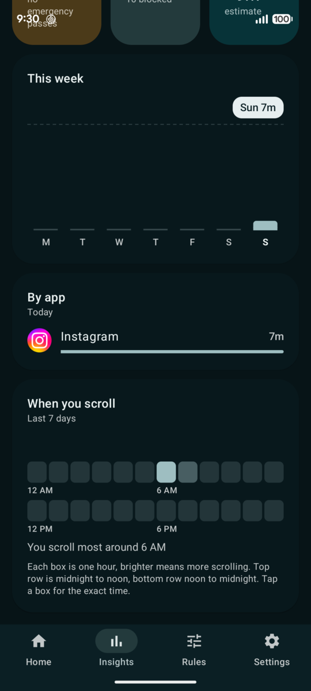
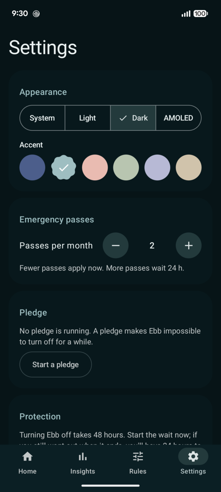

<p align="center"></p>

# Ebb

An Android app blocker that is hard to talk yourself out of. Open a blocked app, pick a session length, and a lockout follows.

**Why:** blockers that you can remove in ten seconds don't help when the urge hits. Ebb puts friction in the way of removing it, not only in the way of the apps.

<p align="center">
  
  
  
  
</p>

## Features

- **Session prompt.** Opening a watched app asks how long you want. Each length carries a lockout once it ends. Defaults (all editable per app):

  | Session | Lockout |
  |---|---|
  | 5 min | 1 h |
  | 15 min | 2 h |
  | 30 min | 4 h |
  | 60 min | 8 h |

- **Daily cap.** Default 60 min per app. Once reached, the app is locked until local midnight, even if used in short bursts.
- **Website blocking.** Each app's website shares its session, lockout and cap, so instagram.com in a browser is gated like the Instagram app. Common apps come with their domains already filled in (YouTube, TikTok, Reddit, X, Facebook and more), and you can edit the list per app under Rules > Websites. Works in Chrome, Brave, Edge, Vivaldi, Firefox, Samsung Internet, Opera and DuckDuckGo. Leaving a blocked site opens a fresh tab instead of Home.
- **Timer chip.** While a session runs, a silent countdown notification shows the time left. On Android 16+ it appears as a chip in the status bar (Live Update).

  

- **Emergency passes.** 2 per calendar month. A 60 s forced wait, then a typed phrase, then 10 minutes in that one app. Each use is logged and resets your streak. No "skip" button exists anywhere.
- **Rules survive uninstalling.** Uninstalling a watched app keeps its rule (shown as "Not installed"), so reinstalling it doesn't reset your limits.
- **Insights.** Today's ring, 7-day bars, per-app breakdown, hour-of-day heatmap, opens vs blocked attempts, streak, estimated time saved.
- **Widgets.** "Today" ring and "Apps" status list (Glance).
- **Themes.** Accent colours, dynamic colour, light/dark/AMOLED.

<p align="center">
  
  
  
  
</p>

## How hard is it to bypass?

Hard, not impossible.

- **Settings guard.** The accessibility service sends you Home when you open Ebb's app info, uninstall dialog, accessibility page, Device Admin page, usage access or battery pages. During a pledge it also covers Date & Time, Developer options and reset pages.
- **Device Admin** blocks plain uninstall.
- **24 h wait on loosening.** Tightening a rule is instant. Longer sessions, shorter lockouts, a higher cap or removing an app wait 24 h, and can be cancelled while pending.
- **Pledge.** Choose 7, 30 or 90 days at setup. A 24-character passcode is shown once (give it to someone else) and only a salted PBKDF2 hash is stored. During a pledge limits can only get stricter, protection can't be disabled, and the passcode is the only way out early. There is no recovery path.
- **After a pledge**, turning protection off takes a 48 h wait plus a typed phrase in the 24 h after it; an unused request then expires and must be filed again. (Ending a pledge early with the passcode does not skip this wait.)
- **Trusted clock.** Time is anchored to elapsed realtime, so changing the system clock never shortens a lockout, cooldown or pledge.

**Known holes:** safe mode, `adb uninstall`, factory reset, and changing the clock while Ebb's service is off, then rebooting (a change made while it runs is undone after a reboot). Website blocking only covers the browsers listed above; other browsers and in-app web views are not checked. The Settings guard matches English text (class names and the app name still work in other languages). Device Owner mode (set up via adb on a freshly reset phone) could close most of these and is a possible future hardening.

## Install

Sideload only; the Accessibility policy makes Play Store distribution unlikely.

1. Build with JDK 17: `JAVA_HOME=/path/to/jdk17 ./gradlew assembleRelease`. Output: `app/build/outputs/apk/release/app-release.apk`. Without a `keystore.properties` the APK is debug-signed (fine for personal use). For your own signing key, copy `keystore.properties.example` to `keystore.properties` and fill it in. Or download the debug APK from the latest CI run's artifacts.
2. `adb install app-release.apk`
3. Open Ebb and follow onboarding: pick apps and tiers, enable Device Admin, grant the usage and battery pages, enable the accessibility service last, then choose a pledge.
4. **Android 13+:** sideloaded apps get the accessibility toggle greyed out. Open Settings > Apps > Ebb > the three-dot menu > **Allow restricted settings**, then enable the service.

## Permissions

- **Accessibility service:** detects which app is in the foreground (window events, no polling) and draws the prompt/block screens over it. In supported browsers it reads only the address bar, to match watched websites. It does not read what you type or the pages you view.
- **Device Admin:** blocks plain uninstall.
- **Notifications:** a silent countdown while a session runs. On Android 16+ it shows as a timer chip in the status bar (Live Update).

Ebb makes no network requests and declares no `INTERNET` permission (checked in the merged release manifest). Nothing leaves your device.

## Tech stack

- Kotlin, Jetpack Compose with Material 3 (Expressive)
- Room: usage events and daily aggregates
- DataStore + kotlinx-serialization: rules, state, pledge
- Glance: home-screen widgets
- Navigation Compose
- Manual DI, no Hilt; charts drawn with Canvas
- R8 and resource shrinking; minSdk 29, target/compile SDK 36

## Project structure

```
app/src/main/java/com/jscyril/ebb/
  engine/   session engine, models, trusted clock (pure Kotlin)
  guard/    pledge, change queue, emergency pass, disable request, guard matcher, Device Admin
  data/     Room, DataStore settings, repository, aggregation
  service/  accessibility service, overlay host, foreground tracking
  widget/   Today and Apps widgets, refresh scheduling
  ui/       theme, overlays, app screens, charts
```

## Development

Requires JDK 17 (Android Gradle Plugin does not support newer system JDKs).

```
export JAVA_HOME=/usr/lib/jvm/java-17-openjdk
./gradlew test            # unit tests
./gradlew lint            # fails on errors, not warnings
./gradlew assembleRelease
```

The debug build installs alongside the release as "Ebb Debug" and has a **Test mode** switch in Settings: rule changes apply instantly, with no 24 h wait and no pledge refusal. It is stripped from release builds.

## Manual device test checklist

Overlays, the guard and widgets can't be unit-tested; check on a device.

**Blocker**
- [ ] Open a watched app: the prompt appears and the app is unusable behind it. Back goes Home; "Not now" goes Home.
- [ ] Pick a tier: the session runs. At the end "Time's up" shows and you are sent Home. Reopening shows the block screen with the unlock time.
- [ ] Reach the daily cap: blocked until midnight.
- [ ] Set the clock back or forward during a lockout: it does not shorten.
- [ ] Reboot mid-lockout: still locked.
- [ ] Screen off then unlock straight into a watched app: it is gated. The keyboard and notification shade don't end a session.
- [ ] Picture-in-picture and split-screen: a locked app is covered, not usable in a small window.
- [ ] While locked, the block screen clears when the lock expires.

**Overlays**
- [ ] Animations (scrim, springing sheet, staggered chips, draining ring) are smooth. Digits don't jiggle. 12h/24h follows the system.
- [ ] Looks right in dark, light, AMOLED and each accent; landscape and small phones fit; covers status and nav bars.
- [ ] Remove animations: waves static, entrances are quick fades.
- [ ] TalkBack: ring reads once, chips read as radio buttons, nothing announces every second.

**Emergency**
- [ ] Block > Emergency opens its own screen, not in recents. Can't proceed for 60 s; rotating does not reset it; leaving and returning restarts it.
- [ ] After 60 s the keyboard appears and the layout lifts above it. Confirm enables only on the exact phrase.
- [ ] Confirm opens the app for 10 min, the pass count drops by 1, Time's up appears at the end.

**Guard**
- [ ] With the service on, these eject you Home with a toast: Ebb's app info, uninstall dialog, Accessibility > Ebb, Device Admin page (when active), Usage access and battery pages for Ebb.
- [ ] Activating Device Admin from onboarding does not eject. Unrelated Settings pages are not ejected.
- [ ] With a pledge: Date & time, Developer options and Reset eject. Without one they don't.
- [ ] `adb uninstall` still works (known hole).

**Pledge, rules and disable**
- [ ] Onboarding: Continue stays disabled until apps, tiers, Admin and the service are set. State updates live after returning from Settings. Picked apps survive a process kill.
- [ ] Pledge passcode shows in groups of 4, lock-in needs the checkbox. A wrong code gives a 30 s lockout; the right code ends the pledge.
- [ ] Tightening a rule saves immediately. Loosening shows a pending card with a 24 h countdown and can be cancelled. During a pledge loosening is refused.
- [ ] Turn protection off: 48 h countdown, cancellable; after it, the phrase is required, then Admin deactivates. After 72 h unused, the request shows as expired.

**Dashboard**
- [ ] Ring sweeps on first open; the tiles are equal height at large font scales.
- [ ] Tapping a bar shows a tooltip and updates "By app". The cap guide sits at the summed cap.
- [ ] Heatmap zero cells are visible in light, dark and AMOLED; the card height does not change when tapping cells.
- [ ] Empty state on a fresh install; upgrade over an older install keeps data.
- [ ] Remove animations: charts show final state. TalkBack reads each chart summary.

**Widgets**
- [ ] Both widgets add and render in day and night; Today resizes through 2x2, 2x1, 4x1, 4x2; Apps follows its height.
- [ ] Starting a session updates Apps within about 2 s. Lock and unlock flip the widget when the device next wakes. Daily cap and midnight reset show correctly.
- [ ] Theme, accent and wallpaper changes re-theme the widgets. Tapping opens Ebb. TalkBack reads full sentences.
- [ ] `adb shell dumpsys alarm | grep com.jscyril.ebb` shows at most one non-waking RTC alarm, and none with no widgets placed.
- [ ] After a reboot, time change or time zone change, the widgets refresh.

**Theme and splash**
- [ ] Fresh install: no white flash; the splash wave rises on API 31+, a static icon on 29/30; the saved theme is used from the first frame.
- [ ] Theme and accent switch live, including AMOLED and dynamic colour. The themed (monochrome) icon looks right.
- [ ] Predictive back on API 34+ previews between tabs and onboarding steps.

## License

[MIT](LICENSE)
